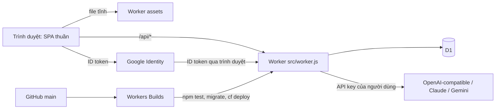

# Kiến trúc hiện tại

VJBot là một Cloudflare Worker duy nhất, vừa phục vụ file tĩnh vừa chạy API, lưu dữ liệu trong D1. Giao diện là HTML/CSS/JavaScript thuần (không framework, không bundler). Tài khoản miễn phí tự gắn API; admin chưa có API riêng dùng OpenAI phía máy chủ.

Thư mục `app/`, `Dockerfile`, `docker-compose.yml` là bản FastAPI + MongoDB cũ, không được deploy và không phải API của website. `wrangler.config.ts` không được dùng (deploy dùng `cloudflare.config.ts`).

## Typed task and attempt boundary

The existing browser adapters now normalize complete source task inventories through `normalizedLessonTasks` / `lessonQuestions`, rather than synthesizing exactly five checks. Stimulus, instruction, marked target, numbered parts, source option positions and explanation are separate fields. Quiz study references no longer represent a solution rationale as a sentence meaning. Original source data and original progress IDs remain unchanged; new recall directions use separate semantic identities.

`taskRevisionSource` is shared by browser WebCrypto and build-time Node SHA-256. Catalog tasks carry the digest; question-specific requests bind canonical lesson, collection/index, task ID and revision before inference or persistence. Invalid original star questions remain tombstones in their original slots, with unavailable notices rather than guessed replacement keys. A revision includes writing criteria/model and source skill/language; it establishes identity only, not reviewed quality.

`src/task-attempts.js` and migration `0022_task_attempt_evidence.sql` extend the existing progress route with durable actual submissions and assistance/reveal evidence. Server comparisons use source numeric option positions or explicit variants. Unreviewed source comparisons are advisory, writing/dictation/flashcard ratings are self-report, and old counters retain a legacy/unknown basis. None becomes verified mastery merely because JSON is valid, the source is canonical, or a learner checked every box. Atomic assistance updates distinguish pre-answer and post-answer help. Account deletion and administrative reset cover the new table; a random profile evidence epoch fences in-flight writes across reset, deletion and account recreation.

All minimum consumers cut over together: choice/recall practice, dedicated writing/dictation, full quiz, teacher focus, inline teaching/chat/coaching, optional canonical read-aloud and progress readback. Help events must save before solution-bearing assistance is displayed. Old task revisions are rejected before provider calls or mutation; source slots and saved historical records are never silently reassigned. Manual completion remains a personal marker, not full-set assessment coverage.

Runtime teaching still uses the selected chat provider, with independent voice configuration. Original/generated comparison is presentation-only; task renderers retain their context/target markup and canonical answer values. Rights/processing restrictions and known quarantine precede model/TTS use. Focused payload limits return actionable errors without automatic chunking, bulk translation or provider fallback. Attributed external RAG remains reference evidence, never grading authority.

`loadN5Teaching` admits the immutable committed N5 editorial package through `ensureLessons`, not a second learning application. The existing curriculum presents its prerequisite-ordered lessons; native practice, teacher catalogs, task-safe coaching and progress reuse the same typed tasks. Source task IDs and original option positions remain stable. Examples retain their context/readings, and contrastive common errors stay reference material rather than pre-answer solution aliases. AI review does not grant scored/mastery eligibility. Curriculum coverage counts only actual submissions matching current task revisions, independently of manual markers and verified assessment.

## Bản đồ mã nguồn

| Đường dẫn | Vai trò |
| --- | --- |
| `src/worker.js` | Điểm vào. Kiểm tra Origin, định tuyến, xác thực phiên, giới hạn tốc độ, các route dữ liệu (hồ sơ, tiến độ SM-2, hoàn thành, lịch sử, chat, Kaiwa, TTS, xóa tài khoản) và trả file tĩnh |
| `src/auth.js` | Đăng ký/đăng nhập mật khẩu (scrypt), xác minh Google ID token, phiên 7 ngày (chỉ lưu băm SHA-256), `is_admin` trong `/api/auth/session` |
| `src/admin.js` | Chủ sở hữu qua Google xác minh + `ADMIN_EMAILS`, vai trò admin ủy quyền qua `admin_grants`, danh sách/chi tiết/thao tác người dùng, `deleteUserData` dùng chung cho xóa tài khoản |
| `src/providers.js` | Phân giải API riêng và OpenAI phía máy chủ cho admin; mã hóa AES-GCM, `/api/ai/*`, `/api/admin/overview`, `askAI`, giọng đọc Gemini |
| `src/llm.js` | Gọi ba loại API (OpenAI-compatible, Anthropic, Gemini), kiểm tra URL, chuẩn hóa lượt hội thoại |
| `src/prompt.js` | Trusted tutor policy and one intent-to-action map shared by native schemas and local validation |
| `src/tutor-chat.js`, `tutor-session.js`, `tutor-context.js` | Canonical item selection, scoped learner-only envelopes, fallible teaching state and database-fenced generation ownership |
| `src/kaiwa.js`, `static/course/kaiwa-rubrics.json` | Authored per-question requirements, strict evidence/verdict validation and server-computed estimated scores; no official grading authority |
| `src/exams.js` | Lưu và kiểm tra trạng thái bài thi thử |
| `cloudflare.config.ts` | Worker `vjbot`, D1, secrets, placement `gcp:us-east4` |
| `migrations/` | D1 schema (0001–0021). Never change applied migrations; add a new file |
| `static/index.html` | Toàn bộ khung trang, dialog đăng nhập, panel các tab |
| `static/app.js` | Điều hướng tab, chat, thẻ nhớ, Kaiwa, quiz, tiến độ, âm thanh |
| `static/account.js`, `ai-settings.js`, `admin-users.js` | Phiên, đăng nhập, `apiFetch`; thẻ API AI trong Cài đặt, panel Quản trị, cổng chat; danh sách và hộp thoại quản lý người dùng |
| `static/teacher-context.js` | `teacherContext()` returns canonical lesson/focus references and route/level metadata only. It remembers learning context for 30 minutes when entering chat; no DOM text or title is sent to inference |
| `static/mascot.js`, `mascot.css` | Nhân vật pixel trong sidebar; bấm mở ô hỏi, hoạt ảnh nghỉ, giảm chuyển động. Không kéo đè lên nội dung |
| `static/learning.js`, `study-plan.js`, `lesson-checks.js`, `completion.js`, `practice.js` | Source lesson adapters, complete typed task inventories, explicit choice/recall/writing/dictation, progress evidence and independent manual markers |
| `static/navigation.js`, `workspace.js` | Route theo hash, sidebar, dashboard, level hub và catalog luyện/thi thử |
| `src/transcription.js`, `static/recorded-input.js`, `speech-input.js` | Kaiwa: bản ghi giới hạn, chép lời OpenAI và nhận diện trình duyệt dự phòng, hủy khi rời bài |
| `src/live.js`, `static/live.js`, `static/live-transcript.js` | Admin Voice liên tục: SDP qua Worker, media WebRTC trực tiếp OpenAI, waveform Web Audio, hội thoại theo mốc thời gian và bản dịch Việt tạm thời; dịch bằng request riêng có giới hạn |
| `src/admin-ai.js`, `static/admin-ai.js` | Catalog model/suy luận hợp lệ, tùy chọn từng admin |
| `static/vi-labels.js` | Nhãn và công thức ngữ pháp tiếng Việt, nạp từ điển dịch |
| `static/*.css` | Nhiều lớp CSS chồng lên nhau, xem [ROADMAP](ROADMAP.md). `surfaces.css` (nạp trước `motion.css`) là hệ thống bề mặt dùng chung: thẻ, pill trạng thái, hộp thoại/popover/overlay, khối bài học, bố cục Cài đặt hai cột. `workbench.css` nạp cuối, điều chỉnh sidebar/chat/catalog; `motion.css` cung cấp token chuyển động (`--ease-out`, `--dur-1..3`) và độ nổi (`--elev-1..3`), hiệu ứng vào trang, so le, hover, hộp thoại; chỉ chạy khi không bật giảm chuyển động |
| `static/course/` | `chapters.json` (40 chương), `practical.json` (20 tình huống), `exams.json`, `*-resources.json`, `vi-grammar.json`, `vi-dict.json` (tùy chọn) |
| `static/openjlpt/` | Dữ liệu OpenJLPT cố định phiên bản (CC BY-SA 4.0) |
| `scripts/` | Python: crawl nguồn, import dữ liệu, `translate_corpus.py` |
| `tests/` | `*.test.mjs` (Node, chạy trong CI) và `test_*.py` (cho `app/` và scripts) |

## Luồng một request

1. `Origin` khác origin của Worker với method ghi: từ chối 403.
2. `/api/auth/*`: `authRoute` (không cần phiên).
3. `/api/ai/*`, `/api/admin/*`: `aiRoute` tự kiểm tra phiên, giới hạn 4 KB body.
4. Các route riêng tư: cần cookie `vj_session`. Worker ghi đè `user_id` bằng chủ phiên, bỏ `api_key` do client gửi, giới hạn 20 KB body, kiểm tra cấp độ. `/api/chat`, `/api/tts`, `/api/kaiwa/evaluate` (và `/api/ai/test`) tính vào hạn mức 20 lần/phút mỗi tài khoản (`ai_usage`).
5. Không khớp route `/api/*`: 404 JSON. Còn lại: file tĩnh, rơi về `index.html`.

## Mô hình dữ liệu (D1)

| Bảng | Nội dung |
| --- | --- |
| `profiles` | Cấp độ, track; `name`, `email` (Google: đã xác minh), `created_at`, `last_login` ghi mỗi lần đăng nhập (migration 0012; 0013 điền lại từ `password_accounts` và `sessions`) |
| `password_accounts`, `auth_attempts` | Danh tính email/mật khẩu (scrypt) và bộ đếm chống dò |
| `sessions` | Băm token phiên, `user_id`, tên, hạn |
| `admins` | `user_id` Google và email đã xác minh lúc đăng nhập |
| `ai_providers` | Mỗi người dùng một API: `protocol`, `base_url`, `model`, `key_enc` (AES-GCM, gắn `user_id`), `key_last4` |
| `app_settings` | Khóa/giá trị chung, hiện chưa dùng |
| `curriculum_lessons`, `curriculum_items` | Danh mục phẳng (10.983 mục) cho `/api/curriculum`, chủ đề tiếp theo |
| `progress`, `progress_attempts` | Bộ đếm SM-2 và biên nhận trả lời an toàn khi thử lại |
| `completions` | Đánh dấu hoàn thành, tách khỏi điểm |
| `exam_attempts` | Trạng thái bài thi thử mới nhất theo đề |
| `conversations` | Tin nhắn chat theo tài khoản, `request_id` chống gửi trùng |
| `tutor_sessions` | Per-account/scope unresolved probe, hint stage, expected learner action, focus, restart boundary and expiring generation lease |
| `tutor_requests` | Request UUID bound to normalized message/action/lesson/focus, scope, completion state and fencing token; conflicting or concurrent reuse returns 409 |
| `study_days`, `ai_usage` | Chuỗi ngày học, bộ đếm hạn mức theo phút |

Xóa tài khoản (`/api/account/delete`) xóa mọi bảng trên theo `user_id`.

## Xác thực và quyền

- **Google**: Worker xác minh chữ ký (JWKS), issuer, audience, hạn, `email_verified` và nonce gắn cookie HttpOnly. Đăng nhập Google ghi `admins` nếu email nằm trong `ADMIN_EMAILS`.
- **Mật khẩu**: scrypt N=16384, r=8, p=5, giới hạn 10 lần/cặp IP+email và 100 lần/IP mỗi 15 phút. Không có xác minh email hay khôi phục mật khẩu; quyền admin chỉ được cấp rõ ràng qua bảng quản trị.
- **Danh tính bắt buộc**: tài khoản Google phải có tên và email đã xác minh trong `profiles`. Phiên Google cũ chưa có email bị hủy ở lần gọi `/api/auth/session` kế tiếp, người dùng đăng nhập lại một lần để ghi lại.
- **Admin**: `isOwner` kiểm tra cả dòng Google đã xác minh trong `admins` lẫn secret hiện tại. `isAdmin` chấp nhận chủ sở hữu hoặc quyền rõ ràng trong `admin_grants` cho Google/email. Thu hồi quyền có hiệu lực ngay, không cần đổi phiên. Chủ sở hữu được bảo vệ khỏi đổi quyền/xóa qua bảng quản trị.

## Lớp AI

- Administrators use the managed server OpenAI connection; regular learners retain their explicit API-key or owned Antigravity selection. Missing configuration fails closed; no inference failure borrows a different account. `X-VJBot-Account` guards stale-tab account changes; `X-VJBot-Profile` pins an explicit selection. Keys never reach static assets or public responses. See [API reference](API_REFERENCE.md#saved-api-profiles).
- `src/llm.js` supports OpenAI-compatible, Anthropic and Gemini protocols, including native schema constraints. Antigravity uses the existing strict-prefix gateway transport and keeps its account isolation; this tutor change does not provision a gateway, authorize sign-in or change provider billing.
- User-supplied API endpoints must be public HTTPS. Local/private addresses, self-hosted site domains, credentials, query strings and fragments are rejected. Requests use manual redirects; provider error bodies and secrets are not returned.
- Each generation has a 28-second provider budget; both browser chat entry points time out after 35 seconds. At most twelve scoped learner messages enter a quoted array, never prior assistant replies. Stored UI dialogue remains unchanged. General chat, individual lessons and quick-chat routes stay isolated. Screen route/level select private scope and level only; no route, title or DOM text enters the model request.
- `scripts/build_teacher_catalog.mjs` retains full addressable words, examples, structured questions, source keys and bindings. Lesson practice and topic exams use the complete normalized inventory with stable source slots. `groundLesson` forwards permitted reference material or the exact task-safe selected question, never answer-bearing aliases in pre-answer context. The browser sends canonical references and question revisions, never authoritative source text. Flashcard focus follows the original stable word ID despite SRS reordering. Invalid membership returns 400; stale/quarantined task references return 409; missing catalogs return 503. Beginner overviews omit ungraded corpus sentences; explicitly selected examples preserve their source and sentence-level limitation.
- `src/tutor-chat.js` requests `{reply,action,open_probe}` with an intent-specific native schema. One action map also governs `parseTutorReply`, avoiding schema/parser drift. Only `reply` reaches UI history. Canonical material, learner attempts and the bounded persisted probe remain fallible quoted evidence; `probe_source` labels model output as unverified. Incomplete/blocked completions and invalid actions fail before persistence, without an unconstrained retry. Omitted focus resumes; clearing a selected item with null resets its probe and exam view. Repeated null preserves overview continuity. Canonical exam/check inventory and retry ownership remain distinct.
- Tutor wording uses natural short paragraphs, one focused hint and no stock section labels. Durable hint stages stop at two; they never automatically unlock a solution. A schema cannot prove that a hint did not leak an answer, that grammar is correct, or that prose obeys the policy. Kana readings annotate whole words or counter units. Semantic quality requires human review of real replies.
- Migration `0019_tutor_sessions.sql` follows upstream migrations 0014–0018 and stores teaching state outside the 12-message window. A database request claim prevents concurrent duplicate generation; a per-scope lease prevents different messages racing the same teaching state. Ownership is renewed after provider/key resolution immediately before inference. Token-fenced writes and reply lookup reject stale completions after lease takeover, chat deletion or account deletion. Completed retries return the saved reply; changed payload or explicit connection selection reuse returns 409. Failed generations preserve prior state.
- Opening an existing lesson chat only restores history. An empty chat starts once; the explicit restart action creates a new model-history boundary while retaining earlier UI history. History/account/admin cleanup removes corresponding teaching state and request claims. Existing pre-cutover replies do not fabricate structured teaching state; the next valid turn establishes it.
- `scripts/build_teacher_catalog.mjs` attaches question-owned rubrics from `static/course/kaiwa-rubrics.json` and fails on missing/mismatched question text. Kaiwa accepts canonical scenario ID/question index and learner transcript, never client-authored rubric, weights or points. `src/kaiwa.js` builds requirement-ID schemas and validates relevance, independent task/grammar/expression verdicts and exact quoted evidence. Missing/extra fields, invented/empty evidence and contradictory off-topic fulfillment fail closed.
- Kaiwa scores are explicitly estimated, never official: task 50% equally split across requirements, grammar 30%, expression 20%; met/partial/not-met contribute 1/0.5/0 and the total rounds once. Missing requirements remain `incomplete`; any uncertainty is ungraded. The server owns the summary and conclusion, while official `score`/`rating` stay null. No progress or completion is awarded. The UI presents criterion evidence and an unverified model example; editing or changing questions clears stale feedback.
- Task relevance, grammar and expression are assessed separately. A recoverable local grammar error earns partial grammar, not a duplicate expression penalty; natural refusals and negative choices remain valid. Exact quotation proves attribution only, not correctness. Known-case model repeats are not held-out accuracy or independent teacher calibration, and prior history/probe injection findings remain unresolved.
- Migration `0015_conversation_scope.sql` preserves all old conversations under `legacy`; these can be read through the archive API but are never fed back into the tutor. General/lesson deletion affects only the selected scope. Quoting, role separation and schema checks reduce attack surface; they do not establish semantic correctness or absolute injection resistance.
- Read-aloud retains the upstream transcript-only TTS fix and separate selected Google Gemini API-key connection. Tutor integration does not reintroduce the duplicate browser TTS implementation or a voice/provider fallback. See [API reference](API_REFERENCE.md#voice-remains-separate).
- `tests/fixtures/tutor-evaluation-cases.json` contains 12 authored Japanese–Vietnamese evaluation scenarios. `scripts/evaluate_tutor.mjs` defaults to offline inspection and always requires human semantic review. Live recording requires explicit opt-in, loopback origin, a session cookie supplied through the environment and a new output file; it uses isolated quick-chat routes, at least 3.1 seconds between request starts, a 35-second step timeout, and no retries or settings changes. No live-model quality claim follows from synthetic regression tests.

## Dữ liệu bài học và ngôn ngữ

- `learning.js` tải `openjlpt/{vocab,grammar,kanji}-nX.json` theo cấp độ, rồi dựng bài học, bài tập và câu kiểm tra ngay trong trình duyệt.
- Giao diện chỉ dùng tiếng Việt và tiếng Nhật. Văn bản gốc OpenJLPT là tiếng Anh; `vi-labels.js` nạp `course/vi-grammar.json` (807 chuỗi ngữ pháp trong lộ trình, dịch tay) và `course/vi-dict.json` (do `scripts/translate_corpus.py` tạo, chưa có). Chuỗi chưa có bản dịch giữ nguyên tiếng Anh.
- Lộ trình = 40 chương ngữ pháp (`chapters.json`) + 20 tình huống thực tế (`practical.json`, tiếng Việt). Thi thử dùng `exams.json` (liên kết đề JLPT chính thức, không sao chép nội dung).

## Giao diện

Một trang, các `section.tab-panel`, chuyển bằng `switchTab` và hash (`#dashboard`, `#classroom`, `#curriculum/N5/lesson/grammar/<id>`, `#settings`, `#admin`). Các script là classic script nạp theo thứ tự cuối `index.html`; hàm toàn cục dùng chung. Landing và hộp đăng nhập nằm trong `landing.css`.
