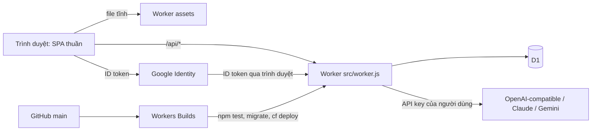

# Kiến trúc hiện tại

VJBot là một Cloudflare Worker duy nhất, vừa phục vụ file tĩnh vừa chạy API, lưu dữ liệu trong D1. Giao diện là HTML/CSS/JavaScript thuần (không framework, không bundler). Không có AI dùng chung: mỗi người dùng tự gắn API của mình.

Thư mục `app/`, `Dockerfile`, `docker-compose.yml` là bản FastAPI + MongoDB cũ, không được deploy và không phải API của website. `wrangler.config.ts` không được dùng (deploy dùng `cloudflare.config.ts`).

## Bản đồ mã nguồn

| Đường dẫn | Vai trò |
| --- | --- |
| `src/worker.js` | Điểm vào. Kiểm tra Origin, định tuyến, xác thực phiên, giới hạn tốc độ, các route dữ liệu (hồ sơ, tiến độ SM-2, hoàn thành, lịch sử, chat, Kaiwa, TTS, xóa tài khoản) và trả file tĩnh |
| `src/auth.js` | Đăng ký/đăng nhập mật khẩu (scrypt), xác minh Google ID token, phiên 7 ngày (chỉ lưu băm SHA-256), `is_admin` trong `/api/auth/session` |
| `src/admin.js` | Quyền admin (tài khoản Google có email đã xác minh nằm trong secret `ADMIN_EMAILS`), danh sách/chi tiết/thao tác người dùng, `deleteUserData` dùng chung cho xóa tài khoản |
| `src/providers.js` | API riêng của từng người dùng: mã hóa AES-GCM, `/api/ai/*`, `/api/admin/overview`, `askAI`, giọng đọc Gemini |
| `src/llm.js` | Gọi ba loại API (OpenAI-compatible, Anthropic, Gemini), kiểm tra URL, chuẩn hóa lượt hội thoại |
| `src/prompt.js` | System prompt lớp học đảo ngược của thầy Lâm |
| `src/exams.js` | Lưu và kiểm tra trạng thái bài thi thử |
| `cloudflare.config.ts` | Worker `vjbot`, D1, secrets, placement `gcp:us-east4` |
| `migrations/` | Lược đồ D1 (0001–0012). Không sửa migration đã chạy; thêm file mới |
| `static/index.html` | Toàn bộ khung trang, dialog đăng nhập, panel các tab |
| `static/app.js` | Điều hướng tab, chat, thẻ nhớ, Kaiwa, quiz, tiến độ, âm thanh |
| `static/account.js`, `ai-settings.js`, `admin-users.js` | Phiên, đăng nhập, `apiFetch`; thẻ API AI trong Cài đặt, panel Quản trị, cổng chat; danh sách và hộp thoại quản lý người dùng |
| `static/teacher-context.js` | Chụp chữ của màn hình học đang mở (`teacherScreen()`), nhớ màn hình vừa rời đi 30 phút để chat và ô ⌘K vẫn biết người học vừa xem gì |
| `static/learning.js`, `study-plan.js`, `lesson-checks.js`, `completion.js`, `practice.js` | Dựng bài học từ dữ liệu, lộ trình, 5 câu kiểm tra, đánh dấu hoàn thành, luyện tập |
| `static/navigation.js`, `workspace.js` | Route theo hash, sidebar, dashboard, level hub |
| `static/vi-labels.js` | Nhãn và công thức ngữ pháp tiếng Việt, nạp từ điển dịch |
| `static/*.css` | Nhiều lớp CSS chồng lên nhau, xem [ROADMAP](ROADMAP.md). `motion.css` nạp cuối cùng: token chuyển động (`--ease-out`, `--dur-1..3`) và độ nổi (`--elev-1..3`), hiệu ứng vào trang, so le, hover, hộp thoại; chỉ chạy khi không bật giảm chuyển động |
| `static/course/` | `chapters.json` (40 chương), `practical.json` (20 tình huống), `exams.json`, `*-resources.json`, `vi-grammar.json`, `vi-dict.json` (tùy chọn) |
| `static/openjlpt/` | Dữ liệu OpenJLPT cố định phiên bản (CC BY-SA 4.0) |
| `scripts/` | Python: crawl nguồn, import dữ liệu, `translate_corpus.py` |
| `tests/` | `*.test.mjs` (Node, chạy trong CI) và `test_*.py` (cho `app/` và scripts) |

## Luồng một request

1. `Origin` khác origin của Worker với method ghi: từ chối 403.
2. `/api/auth/*`: `authRoute` (không cần phiên).
3. `/api/ai/*`, `/api/admin/*`: `aiRoute` tự kiểm tra phiên, giới hạn 4 KB body.
4. Các route riêng tư: cần cookie `vj_session`. Worker ghi đè `user_id` bằng chủ phiên, bỏ `api_key` do client gửi, giới hạn 20 KB body, kiểm tra cấp độ. `/api/chat`, `/api/tts`, `/api/kaiwa/evaluate` (và `/api/ai/test`) tính vào hạn mức 20 lần/phút mỗi tài khoản (`ai_usage`).
5. Không khớp route `/api/*`: 404 JSON. Còn lại: file tĩnh, rơi về `index.html`.

## Mô hình dữ liệu (D1)

| Bảng | Nội dung |
| --- | --- |
| `profiles` | Cấp độ, track; `name`, `email` (Google: đã xác minh), `created_at`, `last_login` ghi mỗi lần đăng nhập (migration 0012) |
| `password_accounts`, `auth_attempts` | Danh tính email/mật khẩu (scrypt) và bộ đếm chống dò |
| `sessions` | Băm token phiên, `user_id`, tên, hạn |
| `admins` | `user_id` Google và email đã xác minh lúc đăng nhập |
| `ai_providers` | Mỗi người dùng một API: `protocol`, `base_url`, `model`, `key_enc` (AES-GCM, gắn `user_id`), `key_last4` |
| `app_settings` | Khóa/giá trị chung, hiện chưa dùng |
| `curriculum_lessons`, `curriculum_items` | Danh mục phẳng (10.983 mục) cho `/api/curriculum`, chủ đề tiếp theo |
| `progress`, `progress_attempts` | Bộ đếm SM-2 và biên nhận trả lời an toàn khi thử lại |
| `completions` | Đánh dấu hoàn thành, tách khỏi điểm |
| `exam_attempts` | Trạng thái bài thi thử mới nhất theo đề |
| `conversations` | Tin nhắn chat theo tài khoản, `request_id` chống gửi trùng |
| `study_days`, `ai_usage` | Chuỗi ngày học, bộ đếm hạn mức theo phút |

Xóa tài khoản (`/api/account/delete`) xóa mọi bảng trên theo `user_id`.

## Xác thực và quyền

- **Google**: Worker xác minh chữ ký (JWKS), issuer, audience, hạn, `email_verified` và nonce gắn cookie HttpOnly. Đăng nhập Google ghi `admins` nếu email nằm trong `ADMIN_EMAILS`.
- **Mật khẩu**: scrypt N=16384, r=8, p=5, giới hạn 10 lần/cặp IP+email và 100 lần/IP mỗi 15 phút. Không có xác minh email hay khôi phục mật khẩu, nên tài khoản này không bao giờ là admin.
- **Admin**: `isAdmin` kiểm tra cả dòng trong `admins` lẫn secret hiện tại, nên xóa email khỏi `ADMIN_EMAILS` là thu hồi ngay. Admin chỉ xem thống kê, không có đặc quyền AI.

## Lớp AI

- Không có khóa hệ thống. `resolveProvider` chỉ đọc API người dùng đã lưu. Chưa lưu: `403 {code:'no_ai'}`; không giải mã được (đổi `AI_KEY_SECRET`): `409 {code:'rekey'}`.
- Ba giao thức trong `src/llm.js`: OpenAI-compatible (`/chat/completions`, Bearer, không gửi `max_tokens`/`temperature`), Anthropic (`/v1/messages`, `x-api-key`, `max_tokens` 1024), Gemini (`generateContent`, `x-goog-api-key`).
- URL do người dùng nhập phải là https công khai: chặn IP, localhost, `.local`/`.internal`, domain của chính site và `workers.dev`, có tài khoản/query/fragment. `redirect: 'manual'`, không trả lại nội dung lỗi của nhà cung cấp.
- Mỗi yêu cầu tối đa 28 giây (trình duyệt hủy sau 35 giây). Lịch sử gửi lên là 12 tin gần nhất, được gộp để luân phiên user/assistant.
- Ngữ cảnh: mọi nơi gọi thầy Lâm (chat, ô ⌘K ở bất kỳ màn hình nào) gửi kèm `screen` (route, tiêu đề, cấp độ, chữ trên màn hình, tối đa 3.500 ký tự). Máy chủ làm sạch rồi đưa vào prompt cùng "LEARNER NOTES" (số mục đã học, 5 mục yếu nhất từ bảng `progress`). Prompt coi cả hai là dữ liệu, không phải chỉ dẫn, và cấm lộ đáp án bài tập đang hiển thị.
- Chat: `reversedPrompt(level, lesson, turns, screen, learner)` ở `src/prompt.js`. Vòng lặp: hỏi một câu, chờ, chẩn đoán đúng câu học viên viết, sửa tối đa hai lỗi, câu tiếp theo khó/dễ hơn; bậc gợi ý; cứ 4 lượt thì bắt tự giải thích lại; xử lý riêng các tin cố định từ nút gợi ý. Chỉ văn bản thuần, tối đa khoảng 110 từ.
- Kaiwa chấm bản chép lời (không chấm phát âm) qua cùng API; kết quả JSON được phân tích tolerant.
- Giọng đọc: Gemini `gemini-3.8-flash-tts` chỉ khi API đã lưu là Gemini trỏ tới Google; nếu không, trình duyệt dùng Web Speech API tiếng Nhật.

## Dữ liệu bài học và ngôn ngữ

- `learning.js` tải `openjlpt/{vocab,grammar,kanji}-nX.json` theo cấp độ, rồi dựng bài học, bài tập và câu kiểm tra ngay trong trình duyệt.
- Giao diện chỉ dùng tiếng Việt và tiếng Nhật. Văn bản gốc OpenJLPT là tiếng Anh; `vi-labels.js` nạp `course/vi-grammar.json` (807 chuỗi ngữ pháp trong lộ trình, dịch tay) và `course/vi-dict.json` (do `scripts/translate_corpus.py` tạo, chưa có). Chuỗi chưa có bản dịch giữ nguyên tiếng Anh.
- Lộ trình = 40 chương ngữ pháp (`chapters.json`) + 20 tình huống thực tế (`practical.json`, tiếng Việt). Thi thử dùng `exams.json` (liên kết đề JLPT chính thức, không sao chép nội dung).

## Giao diện

Một trang, các `section.tab-panel`, chuyển bằng `switchTab` và hash (`#dashboard`, `#classroom`, `#curriculum/N5/lesson/grammar/<id>`, `#settings`, `#admin`). Các script là classic script nạp theo thứ tự cuối `index.html`; hàm toàn cục dùng chung. Landing và hộp đăng nhập nằm trong `landing.css`.
