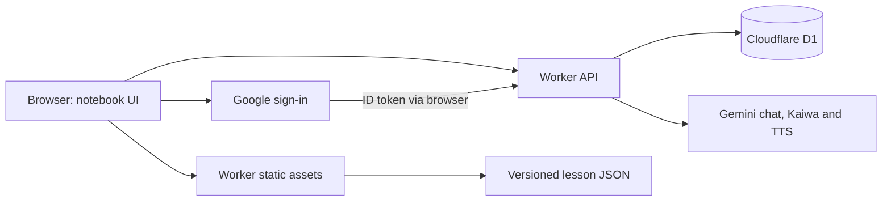

# Production architecture

The deployed app is a Cloudflare Worker with static assets and D1. The Python/FastAPI implementation is separate and is not the deployed API behind the website.

## Source map

| Source | Responsibility |
| --- | --- |
| `src/worker.js` | API routing, D1 queries, SRS scheduling, AI calls and asset responses |
| `src/auth.js` | Google JWT verification, nonce cookies and hashed session tokens |
| `cloudflare.config.ts` | Worker, D1, secrets and placement binding |
| `vite.config.ts` | Cloudflare Vite integration; `static/` as public assets |
| `static/index.html` | Page structure and dialogs |
| `static/app.js` | Navigation, chat, lessons, cards, quizzes and progress UI |
| `static/account.js` | Session setup, Google button, authenticated requests and guest storage |
| `static/study-plan.js` | Guided units, stable review sets and progress-derived next lesson |
| `static/learning.js` | On-demand lessons, furigana and exercise interactions |
| `static/notebook.css` | Notebook design layered over existing `style.css` |
| `src/client/room.js` | Three.js classroom; generated bundle is `static/room.js` |
| `static/assets/lam/teacher.svg` | Original teacher asset; generator in `scripts/build_teacher.py` |
| `static/openjlpt/` | Pinned source data, checksums and license notices |
| `migrations/` | Authoritative D1 schema evolution |

## Database ownership

| Table | Stored data |
| --- | --- |
| `profiles` | Account ID, target level, track, update timestamp |
| `sessions` | SHA-256 session token hash, account ID, name, expiry |
| `curriculum_lessons` | Lesson grouping metadata |
| `curriculum_items` | Search/review item identity, level, display, reading, meanings and source |
| `progress` | Per-account/item counters, review dates, interval, ease and consecutive repetitions |
| `conversations` | Account-scoped user/bot messages and timestamps |
| `progress_attempts` | Per-account answer receipts for safe retry |
| `study_days` | Per-account UTC dates used for streaks |
| `ai_usage` | Per-account minute buckets used for rate limiting |

Migrations `0001_base.sql`, `0002_sessions.sql`, `0003_srs_repetitions.sql` `0004_progress_display.sql` `0005_progress_attempts.sql` and `0006_learning_responses.sql` were applied locally and to production during this work. Read the migration files for exact columns; do not recreate tables from older documentation.

## Lesson data and persistence

The lesson library reads versioned JSON assets and builds lesson groups in the browser. D1 stores a flattened curriculum used by `/api/curriculum`, topic selection and progress joins. Rich examples are not all duplicated into D1. Refreshing content requires rebuilding the asset dataset **and** importing its generated SQL.

Account progress is saved through the Worker into D1. Guest progress and level stay in browser local storage with a simpler review schedule; they do not automatically migrate on sign-in. Generated exercises can have IDs absent from `curriculum_items`; optional display labels are stored directly on each account’s progress row. Older unlabeled records gain labels when answered again.

## Authentication and AI

Google ID tokens are verified using Google's JWKS, RS256, issuer, audience, expiry, verified email and a nonce bound to an HttpOnly cookie. Random 32-byte session tokens expire after seven days; D1 stores only their hashes. HTTPS cookies use Secure and SameSite=Lax. Private routes obtain ownership from the session and ignore client-provided account IDs/API keys.

Worker secrets hold provider credentials. Chat/Kaiwa use `gemini-3.5-flash`; speech uses `gemini-3.8-flash-tts` with the male Charon voice. TTS falls back to browser speech when provider audio is unavailable. Chat uses recent saved messages and bounded lesson context. Kaiwa assesses text/transcription, not audio pronunciation.

The `gcp:us-east4` placement hint resolved an observed Google TTS location rejection. It is not a data-residency guarantee or a measured latency promise.

## Rendering

The classroom uses original procedural geometry and the shared teacher sprite. Animation uses delta time and stops when hidden or settled. Resources are disposed on page exit. A static fallback and HTML object buttons remain available. No React/R3F migration was introduced into this vanilla application.

## Practical course and official resources

`static/course/practical.json` is the editable source for original scenarios, Vietnamese explanations, prerequisites, contextual questions and writing rubrics. `study-plan.js` assembles three steps per unit. Completion uses the latest correct answer; written production is self-assessment. Migration 0006 stores latest correctness and private written responses.

`python3 scripts/crawl_course_sources.py` refreshes `static/course/sources.json` from official Japan Foundation lesson/audio pages. It stores retrieval time, page SHA256, publisher and public links, not PDF/audio bodies. `static/source-catalog.js` exposes the catalog with book/search controls. Irodori copyright terms apply separately from OpenJLPT licensing.

After reviewing course changes, `python3 scripts/upload_practical_course.py` upserts the 20 unit identities and 200 practice identities into the configured production D1. Authored text remains in static JSON; per-account answers remain in D1. Never reassign an existing versioned ID to a different task.

## Completion and level-based learning

Migration `0007_completions.sql` stores explicit learner completion separately from scored attempts. `static/completion.js` provides a shared reversible control; guest storage uses `vjbot_guest_completions`. Chapter completion can be explicitly marked or derived from marked child activities. Quiz identities include the level; previous ambiguous numeric exam IDs remain historical only.

`static/course/chapters.json` maps eight curated chapters per level to pinned OpenJLPT grammar IDs. `scripts/crawl_jlpt_resources.py` reproducibly indexes the official 2018 workbook page into `jlpt-resources.json`; no copyrighted question/audio bodies are copied. `buildLessonContext` supplies bounded real lesson material to the Worker. Its Gemini system instruction asks for explanation/application before feedback. The browser never receives the shared API secret.
