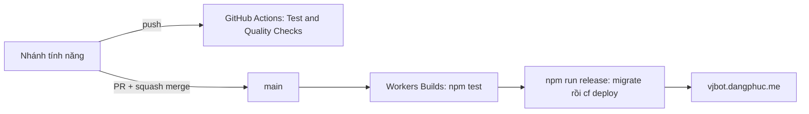

# Triển khai và CI

## Mục tiêu hiện tại

- Site: https://vjbot.dangphuc.me/
- Worker `vjbot`, entrypoint `src/worker.js`, cấu hình `cloudflare.config.ts` + `vite.config.ts`.
- D1 `eb0d49a5-7a90-4219-968c-5fcb04390859`, binding `DB`. Không thay bằng Worker/D1 của dự án khác.
- Placement `gcp:us-east4`: giải quyết lỗi vùng của Google TTS trước đây, không phải cam kết về dữ liệu hay độ trễ. Đừng bỏ khi chưa nghe thử giọng đọc.

## Luồng làm việc của nhóm



- **GitHub Actions** chỉ kiểm tra, không giữ khóa Cloudflare. `ci.yml` chạy trên mọi push: `npm ci`, `npm test`, `npm run build` (dry run). `python.yml` chạy pytest khi `app/`, `scripts/`, test Python hoặc `requirements.txt` đổi.
- **Ruleset "Protect main branch"**: phải qua PR và check tên `Test & Quality Checks` (tên của job trong `ci.yml`; đổi tên job là chặn merge). Thread review phải được giải quyết. Chỉ squash/merge qua PR, không push thẳng.
- **Cloudflare Workers Builds** là nơi duy nhất deploy. Push hoặc merge vào `main` tự chạy. Đồng đội chỉ cần quyền ghi repo, không cần token Cloudflare; muốn xem log build thì cần vào dashboard Cloudflare hoặc dùng `cf builds`.
- Cấu hình (Worker `vjbot` > Settings > Builds, hoặc `cf builds workers get <script-tag>`): nhánh `main`, build `npm test`, deploy `npm run release`, thư mục gốc `/`. Token build cần Workers Scripts Write và D1 Write. **Preview đã tắt**: lệnh mặc định `npx wrangler preview` không chạy được với project `cf`, và preview sẽ dùng chung D1 production (xem [ROADMAP](ROADMAP.md) mục staging).
- Chỉ giữ một lockfile (`package-lock.json`); lockfile thứ hai làm Workers Builds đổi trình quản lý gói.

Xem log build bằng CLI:

```sh
npx cf builds list --external-script-id <worker-id>
npx cf builds logs get <build-uuid>
```

## Lệnh

```sh
npm ci
npm test          # test Node (Worker, dữ liệu, giao diện)
npm run build     # cf deploy --dry-run
npm run migrate   # áp migration D1 production
npm run release   # migrate rồi deploy (Workers Builds dùng lệnh này)
npm run deploy    # chỉ deploy, KHÔNG chạy migration
```

`npm run deploy`, `migrate` và `release` ghi vào production. Chỉ chạy tay khi cần, và ghi lại version trả về.

## Secrets

| Secret | Vai trò |
| --- | --- |
| `GOOGLE_CLIENT_ID` | Xác minh Google ID token (`GOOGLE_CLIENT_SECRET` đã lưu nhưng luồng hiện tại không dùng) |
| `ADMIN_EMAILS` | Danh sách email Google (cách nhau dấu phẩy) trở thành chủ sở hữu sau khi đăng nhập Google; có thể cấp quyền admin trong ứng dụng |
| `AI_KEY_SECRET` | Chuỗi ngẫu nhiên dài để mã hóa API key người dùng. Đổi giá trị làm mọi khóa đã lưu không đọc được |
| `OPENAI_API_KEY` | API key OpenAI phía máy chủ, tự dùng cho quản trị viên chưa có API riêng |
| `OPENAI_MODEL` | Tùy chọn, mặc định `gpt-4.1-mini` |

Đặt secret bằng dashboard (Worker `vjbot` > Settings > Variables and Secrets) hoặc `cf workers secrets update <TÊN> --worker vjbot --type secret_text --text ...`. Không ghi giá trị vào mã, tài liệu, log hay lịch sử shell chia sẻ. Cục bộ: sao chép `.dev.vars.example` thành `.dev.vars` (đã bị ignore), điền các giá trị rồi chạy `npm run migrate -- --local`. Không đổi `AI_KEY_SECRET` của một môi trường đã có API người dùng.

Trước khi triển khai phiên bản này, đặt `OPENAI_API_KEY` và `ADMIN_EMAILS` trên Worker, giữ nguyên `AI_KEY_SECRET`, rồi chạy `npm run release` để áp dụng migration `0020_admin_grants.sql` và `0021_admin_ai_preferences.sql` trước khi triển khai mã. Cấu hình `.dev.vars` chỉ có hiệu lực cục bộ.

Google OAuth cần origin `https://vjbot.dangphuc.me` (và `http://localhost:8787` cho cục bộ). Nút Google hiển thị chưa chứng minh luồng đăng nhập hoạt động.

## Migration và dữ liệu

- Thêm migration mới `migrations/00NN_*.sql`; không sửa file đã chạy. Cập nhật các fixture cơ sở dữ liệu trong test để có bảng mới.
- `npm run release` chạy migration trước khi deploy. Migration lỗi chặn deploy nhưng không tự hoàn tác; rollback Worker không hoàn tác migration, nên viết migration tương thích ngược.
- Làm mới dữ liệu OpenJLPT: `npm run data:import`, `npm test`, `python3 scripts/upload_lessons.py` (ghi thẳng vào D1 production, theo lô 250 câu lệnh, chạy lại được), rồi deploy. Khóa nội dung tình huống: `python3 scripts/upload_practical_course.py`.
- Bản dịch: `scripts/translate_corpus.py` (xem [ROADMAP](ROADMAP.md)). Cần `AI_BASE_URL`, `AI_API_KEY`, `AI_MODEL` của bạn.

## Kiểm tra sau deploy

1. `GET /api/health` trả `status: ok` và `d1_items` đúng (10.983).
2. Mở trang, đăng nhập Google, vào một bài, lưu tiến độ, tải lại.
3. Gắn một API trong Cài đặt, bấm "Lưu và kiểm tra", gửi một tin chat. Log Worker phải có `AI ok own <model>`; nếu là `AI own <model> 401/403/404/429` thì xem thông báo trong Cài đặt.
4. Với admin: mục "Quản trị" hiện và `/api/admin/overview` trả 200.
5. Kiểm tra console trình duyệt.

`/api/health` không chứng minh đăng nhập, lưu dữ liệu hay AI hoạt động.

## Rollback

Dùng version Worker trong dashboard hoặc `cf workers deployments`. Ghi lại version hiện tại trước khi deploy. Dữ liệu D1 không quay lại theo Worker; lên kế hoạch khôi phục riêng (xem [ROADMAP](ROADMAP.md)).

Các secret `ANTIGRAVITY_GATEWAY_URL`, `ANTIGRAVITY_MANAGEMENT_KEY`, `ANTIGRAVITY_API_KEY` chỉ cấu hình trên Worker khi đã có gateway riêng. Chúng không bắt buộc để dùng OpenAI hoặc API riêng. Không đưa giá trị secret vào repo public.

`LOCAL_TEST_ADMIN_PASSWORD` chỉ dành cho Vite dev localhost trong `.dev.vars`; không thêm vào danh sách secret hay binding production. Migration 0021 lưu model, mức suy luận và giọng GPT-Live theo từng admin; không lưu khóa OpenAI. GPT-Live cần quyền truy cập `gpt-live-1` và hạn mức OpenAI đang hoạt động.

## Voice và chép lời

Voice dùng secret `OPENAI_API_KEY` hiện có để mở `gpt-live-1`; Kaiwa chép bản ghi bằng `gpt-transcribe` với API OpenAI đã chọn. Không cần secret mới hoặc migration mới cho đợt cập nhật sidebar/Voice. Giữ nguyên `AI_KEY_SECRET` khi deploy để API cá nhân đã mã hóa vẫn đọc được. Quyền truy cập model và hạn mức OpenAI phải còn hiệu lực.

Sau deploy: đối chiếu asset `workbench.css`, `live.js`, `recorded-input.js` và HTML; kiểm tra `/api/stt`, `/api/live`, `/api/admin/ai` trả 401 khi chưa đăng nhập, `/api/auth/config` có `local_admin:false`, và tài khoản `admin` kiểm thử không đăng nhập được trên public host. Xác minh deployment đang phục vụ commit vừa merge trước khi báo hoàn tất.
