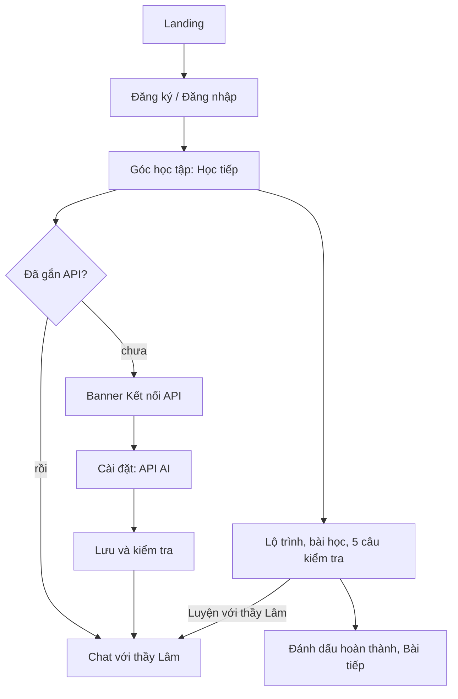

# Tính năng hiện có

Giao diện chỉ dùng tiếng Việt và tiếng Nhật. Mọi tính năng học tập cần đăng nhập. Tài khoản miễn phí tự gắn API để chat và nhận xét Kaiwa. Admin tự dùng OpenAI của máy chủ khi chưa có API riêng.

## Luồng người dùng

## Học

- **Lộ trình N5–N1**: 40 chương ngữ pháp (8 mỗi cấp, 163 mẫu câu, giải thích tiếng Việt) và 20 tình huống thực tế viết riêng bằng tiếng Việt (N5: 6, N4: 5, N3: 4, N2: 3, N1: 2). Mỗi tình huống gồm từ cần dùng, hiểu tình huống, tự trả lời bằng văn bản, Kaiwa và bài kiểm tra riêng. Chương kana là tùy chọn.
- **Thư viện**: từ vựng, ngữ pháp, Hán tự, đọc, nghe, viết theo cấp độ (10.720 mục OpenJLPT: 7.811 từ, 526 ngữ pháp, 2.383 Hán tự; 20 bài kana). Phần từ vựng/Hán tự/câu ví dụ trong thư viện còn tiếng Anh cho đến khi chạy `scripts/translate_corpus.py`.
- **Mỗi bài**: tham khảo, 5 câu kiểm tra dựng từ chính ví dụ và bài tập của bài, xem lại câu sai, nút "Luyện với thầy Lâm" (cố định ở đáy màn hình), đánh dấu hoàn thành có thể hoàn tác (độc lập với điểm).
- **Thẻ nhớ**: buổi 20 thẻ ưu tiên thẻ đến hạn, lịch SM-2 (đặt lại sau khi sai).
- **Luyện nói (Kaiwa)**: gõ hoặc nói (nhận dạng giọng nói của trình duyệt); AI chấm bản chép lời, không chấm phát âm.
- **Bài luyện JLPT**: bộ câu hỏi theo chủ đề và bài thi thử có tính giờ theo từng phần dựa trên đề chính thức 2012/2018 (liên kết tới nguồn; điểm thô, không phải thang điểm JLPT). Mỗi đề lưu bài làm gần nhất.
- **Tiến độ**: số mục, độ chính xác, chuỗi ngày, bài đã hoàn thành, sổ điểm yếu.

## Lớp học đảo ngược cùng thầy Lâm

Người học đã đọc bài; trong chat thầy hỏi, em tự nói và viết. Mỗi lượt: một câu hỏi, chờ trả lời, chẩn đoán đúng câu học viên viết, sửa tối đa hai lỗi kèm lý do, rồi một câu tiếp theo khó hơn hoặc dễ hơn. Có bậc gợi ý, nhắc "tự giải thích" mỗi 4 lượt, tóm tắt khi "kết thúc". Các nút gợi ý nhanh gửi những câu cố định mà prompt đã biết cách xử lý. Chi tiết trong `src/prompt.js`.

Thầy Lâm hiểu người học đang xem gì ở bất kỳ màn hình nào (bài học, thẻ nhớ, quiz, Kaiwa, lộ trình): ô ⌘K và chat đều gửi kèm chữ trên màn hình và vài mục người học hay sai, nên "câu này", "từ này" được hiểu đúng; với bài tập đang làm, thầy gợi ý chứ không đưa đáp án. Chat mang theo bài đang học (cấp độ, tiêu đề, mục tiêu, nội dung giới hạn 4.000 ký tự), có thử lại/bỏ qua khi lỗi, `request_id` chống gửi trùng, và không lưu lượt bị lỗi vào lịch sử.

## API AI của người dùng

Cài đặt > API AI: chọn OpenAI-compatible, Claude (Anthropic) hoặc Gemini, nhập URL (bỏ trống để dùng mặc định), model và API key; "Lưu và kiểm tra". Khóa được mã hóa phía máy chủ và không bao giờ hiển thị lại (chỉ 4 ký tự cuối). Chưa có API thì ô chat bị khóa và có nút dẫn tới Cài đặt.

## Quản trị

Chủ sở hữu (Google có email đã xác minh trong `ADMIN_EMAILS`) và tài khoản được cấp quyền admin thấy mục "Quản trị": số người dùng, người hoạt động 7 ngày, tin nhắn 24 giờ, số người dùng API riêng, danh sách hoạt động nhiều nhất, và **quản lý người dùng**: tìm theo tên/email/ID, xem chi tiết (loại tài khoản, cấp độ, số tin, tiến độ, phiên đang mở, API đã lưu), đổi cấp độ, xóa lịch sử chat, đặt lại tiến độ, xóa API đã lưu, đăng xuất mọi thiết bị, xóa tài khoản. Nút "Dọn tài khoản khách cũ" xóa các hồ sơ ẩn danh từ trước khi có đăng nhập. Tên và email của mọi tài khoản được lưu để quản lý; tài khoản Google cũ chưa có email phải đăng nhập lại một lần. Mỗi thao tác phá hủy đều hỏi xác nhận. Admin có thể cấp/thu hồi quyền admin cho tài khoản Google hoặc email đã đăng ký. Quyền dùng OpenAI chung thay đổi ngay ở yêu cầu tiếp theo. Không thể tự đổi quyền hay đổi quyền/xóa chủ sở hữu. Admin không đọc được nội dung chat.

## Tài khoản và dữ liệu

Google và email/mật khẩu (không có xác minh email hay khôi phục mật khẩu). Xóa tài khoản xóa toàn bộ dữ liệu của tài khoản, kể cả API đã lưu. Tiến độ khách không có: mọi tuyến học cần đăng nhập.

## Giao diện

Cài đặt chia hai cột (menu bên trái, thẻ bên phải): thẻ tài khoản (tên, email, loại đăng nhập, đăng xuất), thẻ API AI có chọn loại API dạng nút, gợi ý model, hiện/ẩn khóa và nhãn trạng thái (Chưa kết nối, Đã lưu, Kết nối được, Lỗi), thẻ âm thanh, thẻ xóa dữ liệu có nút đỏ. Trang bài học có cột "Trong chương" bên phải (vị trí hiện tại, bài đã xong, bấm để chuyển bài), khối cấu trúc, giải thích và thẻ ví dụ đánh số. Hộp đăng nhập, ô hỏi ⌘K, bảng chọn cấp độ và hộp quản trị dùng chung một khung. Hộp đăng ký có thanh độ dài mật khẩu, trường sai được viền đỏ, nút gửi có vòng chờ.

Thầy Lâm pixel đi dạo quanh trang: rê chuột thì dừng và chào (nhắc đúng màn hình em đang xem), bấm để hỏi, kéo thả đến bất kỳ chỗ nào, nhấp đúp để về chỗ cũ.

Giấy ấm, sidebar thu gọn (rail 76 px, mở rộng được), landing có khung chat minh họa, hộp đăng nhập hai cột, nút cảm ứng tối thiểu 44 px trên điện thoại, tôn trọng `prefers-reduced-motion`. Ảnh thầy Lâm là Avataaars có giấy phép (xem `static/assets/lam/ATTRIBUTION.md`).

## Nguồn và giấy phép

OpenJLPT, bản `0d1d3410bec90bd4098a7c72de820543cb4f707c` (`evanclan/OpenJLPT`), CC BY-SA 4.0: xem [NOTICE](../static/openjlpt/NOTICE.md), [LICENSE](../static/openjlpt/LICENSE), [manifest](../static/openjlpt/manifest.json) và trang [Nguồn](https://vjbot.dangphuc.me/sources.html). Tài liệu Irodori và JLPT/Japan Foundation chỉ được liên kết, không sao chép. Mức độ N5–N1 của OpenJLPT là ước lượng của cộng đồng, không phải danh sách chính thức.

## Hội thoại, giọng nói và mascot

Ô hỏi nhanh ⌘K dùng cùng lịch sử hội thoại, chặn gửi trùng và giữ nguyên mã yêu cầu khi thử lại. Ghi âm tiếng Nhật có nút dừng, giữ lỗi micro để sửa và giải phóng thiết bị khi chuyển màn hình. Có thể nhập câu trả lời trên trình duyệt không hỗ trợ nhận diện; Kaiwa chỉ nhận xét nội dung bản chép lời. Giọng AI dùng OpenAI chính thức hoặc Gemini-Google và có giọng trình duyệt dự phòng; nút Dừng đọc hủy cả yêu cầu đang tải.

Mascot lớn ở góc màn hình máy tính; kéo hoặc dùng phím mũi tên để di chuyển, Home để trở về góc. Trên điện thoại, mascot nằm trong nút Hỏi thầy Lâm trên thanh đầu để không che nội dung. Favicon là khuôn mặt từ cùng sprite. Chuyển màn hình, hộp thoại và phản hồi bấm dùng cùng nhịp chuyển động; tắt chuyển động khi người dùng chọn giảm chuyển động.

## Compact workspace and GPT-Live

- Dashboard: next lesson, actual completion/review/streak counts, a compact chapter index and practice shortcuts. No mock progress figures.
- Lesson library and practice lists: search, completion filters and 24-row pagination. Roadmap: search and grammar/situation/supplement filters.
- Settings: independent account, AI connections, admin models, sound and data views, each with its own hash route. Opening account settings does not scan AI connections or fetch voice catalogs.
- Admin text models: GPT-4.1 mini, GPT-5 mini, GPT-5.4 mini and GPT-5.4; reasoning options are restricted by model. Each admin keeps their own choices.
- Live teacher: admin-only GPT-Live with microphone, live Japanese captions, mute/end controls, AI voice selection, connection failure cleanup and a ten-minute client session limit. Audio is sent to OpenAI; captions are not persisted.
- The mascot portrait is shared by the sidebar, SVG/ICO favicon and touch icon. The larger companion stays in the desktop navigation area; mobile keeps the accessible topbar button. Reduced motion keeps all controls usable.
