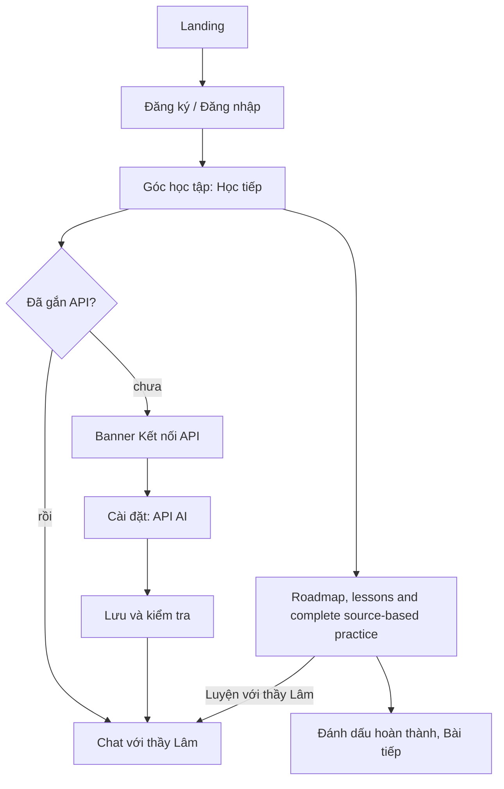

# Tính năng hiện có

Learning features require sign-in. Regular learners bring their own API-key or OAuth connection. Administrators automatically use server OpenAI for chat, coaching, read-aloud and GPT-Live; they configure text models, reasoning and live voice without entering a personal key. Existing personal connections remain saved and are not erased by role changes.

## Luồng người dùng

## Học

- **Reference curriculum N5–N1**: 40 grammar chapters (eight per level, 163 patterns with Vietnamese explanations) and 20 original Vietnamese practical units (N5: six, N4: five, N3: four, N2: three, N1: two). Each practical unit links vocabulary, situation reading, written production, Kaiwa and its own review tasks. Kana is optional. The additional guided AI-authored chapters described below are separate from those 40 original chapters; neither grouping implies publisher approval.
- **Library**: vocabulary, grammar, kanji, reading, listening and writing by level (10,720 OpenJLPT entries: 7,811 words, 526 grammar points, 2,383 kanji; 20 kana lessons). Original English glosses remain attributed source data. **Nhờ thầy giảng bài** uses the selected chat API to translate the current presentation and teach from canonical lesson evidence on demand, rather than requiring a bulk corpus translation.
- **Lesson activities**: reference material and the actual available task inventory, without fixed-five padding. Questions retain their passage/dialogue, explicit target, numbered arrangement parts and original option positions. Source explanations appear after an attempt, never as fake sentence meanings. Known contradictory star tasks are temporarily unavailable in their original slots, not silently corrected or removed.
- **Thẻ nhớ**: buổi 20 thẻ ưu tiên thẻ đến hạn, lịch SM-2 (đặt lại sau khi sai).
- **Luyện nói (Kaiwa)**: gõ hoặc ghi âm để chép lời (OpenAI chính thức, nhận diện trình duyệt cho kết nối khác); AI chấm bản chép lời, không chấm phát âm.
- **Bài luyện JLPT**: bộ câu hỏi theo chủ đề và bài thi thử có tính giờ theo từng phần dựa trên đề chính thức 2012/2018 (liên kết tới nguồn; điểm thô, không phải thang điểm JLPT). Mỗi đề lưu bài làm gần nhất.
- **Progress evidence**: actual submitted choices/text and task revisions are retained separately from old counters. Source-key comparisons are advisory until independently reviewed; writing/dictation/flashcard self-ratings, AI estimates, manual completion and verified assessment remain distinct. An unavailable or unattempted slot cannot become full-set completion.
- **Recall and production**: source-grounded reading/form recall uses text entry rather than renamed multiple choice. Writing has explicit criteria and a deliberate source-model reveal. Dictation retains the pre-reveal attempted text and self-rating without pretending the learner's checkbox proves acoustic comprehension. These activities do not fall through into an unrelated generic quiz.
- **Runtime teaching**: explicit selected-chat assistance, task-version ownership, help saved before disclosure and original/generated comparison. Generated prose is labeled advisory and never changes canonical option values or keys. Voice continues using its independent saved configuration; no background corpus translation or automatic provider retry is introduced.
- **N5 contextual teaching packages**: twenty original prerequisite-ordered grammar packages remain unchanged. Six additional guided practical packages cover introductions, ordering, times, transport, shopping and asking for help. N5 now has 26 AI-authored packages, 118 contextual examples, 52 common-error contrasts and 130 authored tasks (78 choices, 52 constrained-text responses). Constrained reconstruction is supplementary rehearsal, not proof of learner-chosen communication or approval as a primary beginner self-study course.
- **N4–N1 contextual drafts**: fourteen further packages cover every original advanced practical objective: N4 five, N3 four, N2 three and N1 two. They add 44 contextual examples, 33 common-error contrasts and 70 authored tasks (42 choices, 28 constrained-text responses). Examples and tasks practice notices, conditions, evidence, comparisons and bounded arguments; passages, original option positions and explicit provisional variants remain distinct. These packages do not rewrite or certify every imported OpenJLPT lesson.
- **Shared draft boundary**: all five levels use the existing curriculum, lesson, canonical teacher and progress paths, not a second grading system. Source comparisons remain advisory, not human-reviewed assessment or mastery credit. Curriculum shows revision-matched attempted coverage separately from personal completion markers. Draft implementation can continue; user quality review is required before merge. Independent AI review is not human pedagogical approval.

## Lớp học đảo ngược cùng thầy Lâm

Người học đã đọc bài; trong chat thầy hỏi, em tự nói và viết. Mỗi lượt: một câu hỏi, chờ trả lời, chẩn đoán đúng câu học viên viết, sửa tối đa hai lỗi kèm lý do, rồi một câu tiếp theo khó hơn hoặc dễ hơn. Có bậc gợi ý, nhắc "tự giải thích" mỗi 4 lượt, tóm tắt khi "kết thúc". Các nút gợi ý nhanh gửi những câu cố định mà prompt đã biết cách xử lý. Chi tiết trong `src/prompt.js`.

Classroom and quick chat resolve the current canonical lesson/item across lessons, flashcards, quizzes, Kaiwa and curriculum. They send identifiers, task revisions and route/level metadata, not arbitrary screen text or learner-authored progress labels. The server supplies bounded task-safe evidence and scoped learner history. Requests support explicit retry/discard and idempotent `request_id`; failed generations do not become saved successful turns. Pre-answer question assistance excludes source keys and solution aliases, without claiming that prompts alone prevent every answer leak.

## API AI của người dùng

Cài đặt > API AI: chọn OpenAI-compatible, Claude (Anthropic) hoặc Gemini, nhập URL (bỏ trống để dùng mặc định), model và API key; "Lưu và kiểm tra". Hồ sơ API có thể lưu trên thiết bị (IndexedDB, AES-GCM) hoặc máy chủ (AES-GCM). Danh sách chỉ hiển thị 4 ký tự cuối. Tài khoản miễn phí chưa kết nối API thấy ô chat khóa và nút dẫn tới Cài đặt; admin có thể dùng OpenAI của Worker.

## Quản trị

Chủ sở hữu (Google có email đã xác minh trong `ADMIN_EMAILS`) và tài khoản được cấp quyền admin thấy mục "Quản trị": số người dùng, người hoạt động 7 ngày, tin nhắn 24 giờ, số người dùng API riêng, danh sách hoạt động nhiều nhất, và **quản lý người dùng**: tìm theo tên/email/ID, xem chi tiết (loại tài khoản, cấp độ, số tin, tiến độ, phiên đang mở, API đã lưu), đổi cấp độ, xóa lịch sử chat, đặt lại tiến độ, xóa API đã lưu, đăng xuất mọi thiết bị, xóa tài khoản. Nút "Dọn tài khoản khách cũ" xóa các hồ sơ ẩn danh từ trước khi có đăng nhập. Tên và email của mọi tài khoản được lưu để quản lý; tài khoản Google cũ chưa có email phải đăng nhập lại một lần. Mỗi thao tác phá hủy đều hỏi xác nhận. Admin có thể cấp/thu hồi quyền admin cho tài khoản Google hoặc email đã đăng ký. Quyền dùng OpenAI chung thay đổi ngay ở yêu cầu tiếp theo. Không thể tự đổi quyền hay đổi quyền/xóa chủ sở hữu. Admin không đọc được nội dung chat.

## Tài khoản và dữ liệu

Google và email/mật khẩu (không có xác minh email hay khôi phục mật khẩu). Xóa tài khoản xóa toàn bộ dữ liệu của tài khoản, kể cả API đã lưu. Tiến độ khách không có: mọi tuyến học cần đăng nhập.

## Giao diện

Cài đặt chia hai cột (menu bên trái, thẻ bên phải): thẻ tài khoản (tên, email, loại đăng nhập, đăng xuất), thẻ API AI có chọn loại API dạng nút, gợi ý model, hiện/ẩn khóa và nhãn trạng thái (Chưa kết nối, Đã lưu, Kết nối được, Lỗi), thẻ âm thanh, thẻ xóa dữ liệu có nút đỏ. Trang bài học có cột "Trong chương" bên phải (vị trí hiện tại, bài đã xong, bấm để chuyển bài), khối cấu trúc, giải thích và thẻ ví dụ đánh số. Hộp đăng nhập, ô hỏi ⌘K, bảng chọn cấp độ và hộp quản trị dùng chung một khung. Hộp đăng ký có thanh độ dài mật khẩu, trường sai được viền đỏ, nút gửi có vòng chờ.

Lesson reference cards conceal readings and meanings until opened independently with native keyboard-accessible disclosures. Vocabulary and kanji rows reveal their answers only when opened; nested examples retain separate reading/meaning controls. Reading translations and listening transcripts also start collapsed. Japanese-only Listen buttons retain the independent saved voice account/model, canonical reading metadata and existing cancellation/error handling. Revealing a learning aid does not request speech or refresh the model catalog.

Runtime teaching is available on lesson references, opened words/kanji, complete lesson task collections, writing and dictation references, flashcard backs, Kaiwa prompts and topic quizzes. It explains one idea and asks a short self-check. **Em vẫn chưa hiểu** opens an inline conversation with Thầy Lâm below the explanation instead of regenerating it. The learner explicitly sends a question through the existing tutor endpoint, with canonical lesson/focus references and a private quick-chat scope for that panel. Coaching hints and feedback offer the same follow-up. Closing the box restores focus; item, route, account or chat-connection changes cancel pending replies and clear its private draft and transcript.

Translated labels retain original option indices, selected answers and canonical source comparisons. An explicit original/generated comparison keeps source context, markup and repeated numbered arrangement segments intact. Full topic quizzes use the same complete normalized inventory as lesson practice; official external exam PDFs are unchanged.

No teaching request runs on page entry, revealing content, opening the follow-up box or choosing an answer. Only explicit teaching or message submission uses the selected chat connection and quota, not the separate voice connection. Failed messages retain the question and offer an explicit same-request retry or a new question. Errors do not fabricate a translation or block ordinary practice. Structural validation and synthetic tests do not certify Japanese pedagogy.

Thầy Lâm stays in the sidebar with idle animation and contextual quick questions. The topbar action remains available when navigation is collapsed or closed; keyboard and reduced-motion controls remain usable without covering lessons.

## Không gian học và Voice

- Sidebar 232 px có nhãn trên máy tính; tablet 740–1099 px mặc định dùng rail 72 px và có nút mở rộng. Dưới 740 px dùng drawer, đóng bằng Escape hoặc nền, giữ focus trong menu và trả focus về nút mở. Có nhóm Học tập, Luyện tập, quản trị/cài đặt và tài khoản.
- Dashboard: tiếp tục bài đang học, tiến độ thực, khóa học và lịch sử hoàn thành. Bài học có tìm kiếm, lọc hoàn thành và phân trang.
- Bài luyện JLPT: hai mục **Luyện theo bài** và **Thi thử có giờ**. Bài ngắn có tìm kiếm/lọc tiến độ; đề chính thức giữ đồng hồ, đáp án đã lưu và cơ chế tự đối chiếu. Không tuyên bố điểm thi chứng chỉ.
- Chat: một cột hội thoại, ô soạn luôn ở cuối, công cụ ngắn thành hai hàng trên điện thoại. Admin nhấn **Voice** để tự mở micro và bắt đầu GPT-Live; không cần gửi từng bản ghi.
- Voice: âm thanh hai chiều qua WebRTC, sóng âm đo từ micro và giọng thầy, dòng hội thoại theo thời gian với tên học viên/thầy, lời gốc và bản dịch Việt bên dưới, tắt/bật micro, kết thúc và về nhắn tin. Phiên tối đa 10 phút phía client. Mốc thời gian xấp xỉ lấy từ phiên nói, ghép đoạn cùng người nói cách nhau không quá 1,2 giây, tách ở cuối câu hoặc sau 8 giây; không phải ranh giới lượt nói do model xác nhận. Bản dịch được gom nhóm và chạy riêng, không chặn âm thanh; lỗi dịch có nút thử lại. Phụ đề và bản dịch không lưu vào lịch sử chat; chuyển từ chat sang Voice không tự chuyển lịch sử chat sang phiên nói.
- Kaiwa: ghi một câu rồi dừng để chép lời bằng `gpt-transcribe` khi dùng OpenAI chính thức (API riêng hoặc mặc định admin). Ghi tối đa 60 giây/2 MiB, nghe lại và sửa bản chép trước khi chấm. Nhà cung cấp khác dùng nhận diện trình duyệt nếu hỗ trợ; luôn có thể nhập tay. Chỉ đánh giá nội dung bản chép, không chấm phát âm.
- Administrator AI: 13 text models with model-specific reasoning and per-admin choices. Settings apply to new text requests and new live sessions. Administrators use server OpenAI automatically; saved personal credentials are retained but not selected.
- Regular learners bring their own API/OAuth connections, including an official OpenAI key. Only administrators can use the Worker's shared key and continuous GPT-Live. The server key never appears in browser bundles or API responses.
- Favicon SVG/ICO và biểu tượng cảm ứng dùng cùng chân dung với sidebar. Lần tải dashboard không tự quét model hay danh mục giọng nói.
- Settings: learners see saved API/OAuth connections and an independent voice account. Administrators see managed OpenAI model/reasoning/live-voice preferences and read-aloud, without personal-key forms. Opening settings never scans models or generates content automatically.

Quick chat keeps scoped conversation history, prevents duplicate submissions and reuses request IDs only for explicit retries. Recordings and browser recognition keep manual entry available; Kaiwa grades only the submitted transcript. Learner read-aloud uses the independent native Gemini/official OpenAI selection; administrator read-aloud uses managed OpenAI. Stop cancels owned loading/playback, without silently switching accounts or using browser speech as a fallback.

## Nguồn và giấy phép

OpenJLPT, bản `0d1d3410bec90bd4098a7c72de820543cb4f707c` (`evanclan/OpenJLPT`), CC BY-SA 4.0: xem [NOTICE](../static/openjlpt/NOTICE.md), [LICENSE](../static/openjlpt/LICENSE), [manifest](../static/openjlpt/manifest.json) và trang [Nguồn](https://vjbot.dangphuc.me/sources.html). Tài liệu Irodori và JLPT/Japan Foundation chỉ được liên kết, không sao chép. Mức độ N5–N1 của OpenJLPT là ước lượng của cộng đồng, không phải danh sách chính thức.
