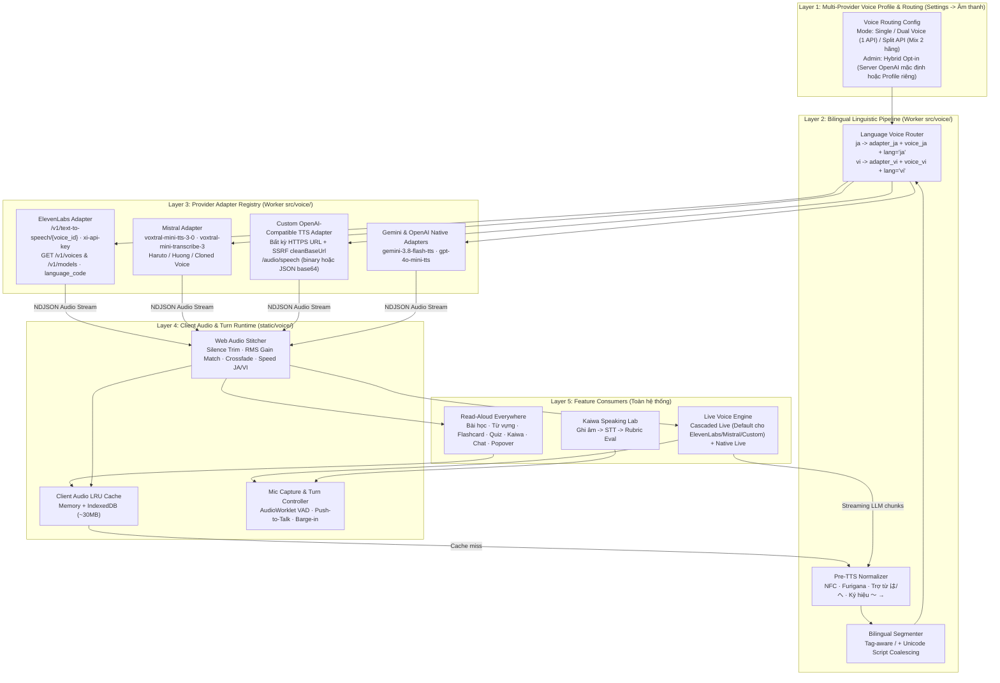
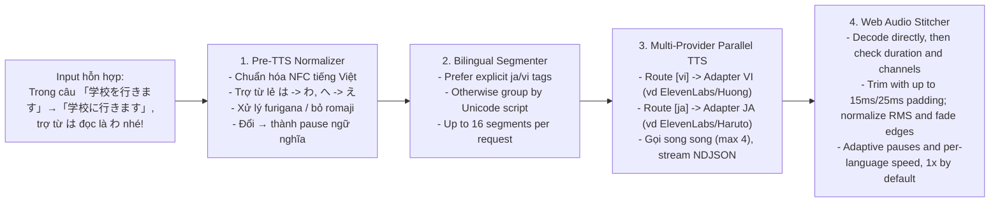
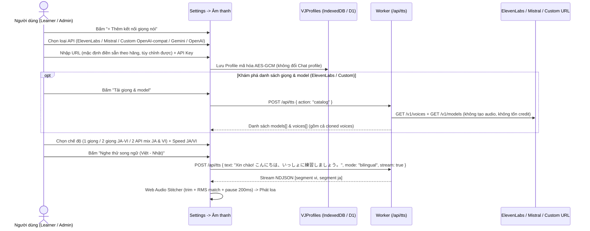
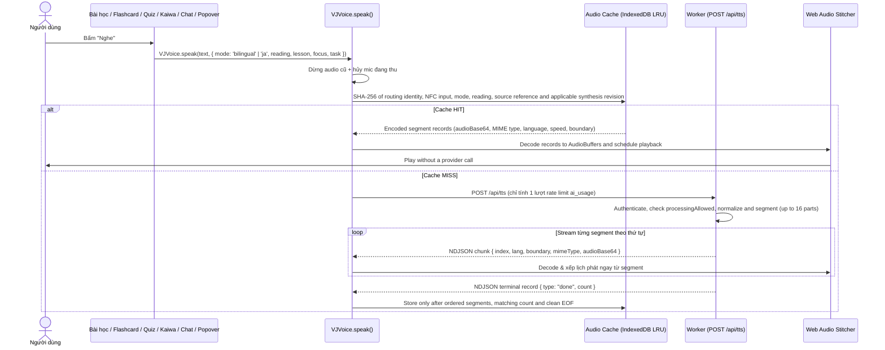
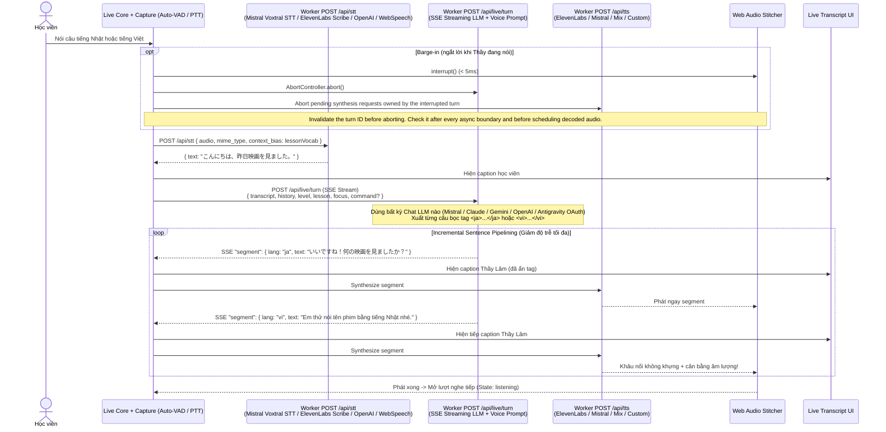

# Thiết kế Framework & Workflow cho Phân hệ Voice v2 (Multi-Provider: ElevenLabs · Mistral · Custom TTS URL)

Tài liệu này định nghĩa kiến trúc **VJBot Voice Framework v2** và các **Workflow end-to-end** để:
1. Hỗ trợ **đa nhà cung cấp TTS API** cho mọi người dùng — trọng tâm là **ElevenLabs** và **Mistral**, đồng thời cho phép gắn **bất kỳ URL + API Key TTS nào** (chuẩn OpenAI-compatible `/audio/speech`, cộng Gemini/OpenAI native).
2. **Giải quyết tận gốc bài toán đọc song ngữ Nhật–Việt** (kể cả khi mix 2 hãng khác nhau, ví dụ ElevenLabs ↔ Mistral, hoặc dùng 1 giọng clone duy nhất).
3. **Nối thống nhất nguồn TTS vào TOÀN BỘ tính năng voice**: Read-aloud toàn app (bài học, từ vựng, flashcard, quiz/exam, Kaiwa, popover, tin nhắn chat) **và cả Live Voice** (hội thoại trực tiếp).

---

## 1. Phân tích nguyên nhân gốc (từ dữ liệu chạy thực tế)

Từ lịch sử triển khai trên VJ_BOT (các PR `#65`–`#75`):

1. **Đọc trộn Nhật–Việt trong 1 lần gọi TTS là nguồn gốc lỗi vỡ giọng / cắt cụt âm:**
   - Ở `#74`, Mistral cloned voice (`01a21304-...`) đọc câu thuần Việt hoặc thuần Nhật qua `/v1/audio/speech` đều sạch.
   - Ở `#67` và `#73`, lỗi vỡ tiếng (cloned voice degenerate) và lỗi cắt cụt âm (Haruto dừng đột ngột ở `"こんにちは、em。"`) xảy ra ngay khi trộn 2 hệ chữ trong cùng 1 chuỗi.
2. **Read-aloud hiện tại không tách ngôn ngữ và khóa cứng 3 domain:**
   - [`mistralVoice()`](../src/speech.js#L76-L79) chỉ cần thấy 1 ký tự Latin là ép toàn bộ đoạn sang giọng Việt `Huong`.
   - [`resolveSpeechProvider()`](../src/providers.js#L91-L112) chặn mọi URL ngoài Gemini / OpenAI / Mistral chính thức → không cắm được **ElevenLabs** hay **Custom TTS server**.
3. **Native Live Voice đóng kín, không cắm được TTS tùy chọn:**
   - Mistral Voice Agents (LiveKit), OpenAI GPT-Live và Gemini Live đều khóa cứng TTS nội bộ của hãng; riêng Mistral LiveKit còn bị mất toàn bộ `VOICE_COMMANDS` (`commands: {}`).
4. **Cấu hình TTS/STT/Live bị tách rời:**
   - TTS dùng Sound profile, còn STT & Live lại phụ thuộc Chat profile → người dùng gắn ElevenLabs/Mistral ở Âm thanh nhưng chat bằng OAuth/model khác không tận dụng đồng bộ được.

> **Nguyên lý cốt lõi của Framework v2:**
> **Mọi văn bản song ngữ đều được chuẩn hóa và tách thành từng đoạn thuần ngôn ngữ (`ja` / `vi`) trước khi gọi TTS**, sau đó định tuyến qua **Multi-Provider TTS Adapter Registry** (Mistral / ElevenLabs / Custom URL / OpenAI / Gemini) và khâu nối mượt trên client bằng **Web Audio Stitcher**.

---

## 2. Kiến trúc tổng thể 5 lớp (Voice Framework v2)



---

## 3. Đặc tả Multi-Provider TTS Adapters (ElevenLabs · Mistral · Custom URL)

Mọi provider đều đi qua chung một interface backend `TTSAdapter`:
- `synthesize({ text, lang, voiceId, model, speed, format, prevText, nextText }, provider)` → `{ audioBase64, mimeType, voice, model }`
- `listCatalog(provider)` → `{ models[], voices[] }` *(tải danh sách model & giọng nói có sẵn mà không tạo âm thanh)*

### 3.1. Bảng đặc tả 5 Adapter

| Adapter (`protocol`) | Endpoint & Auth | Model khuyến nghị cho VI–JA | Tính năng đặc thù & Lưu ý quan trọng |
| --- | --- | --- | --- |
| **`elevenlabs`** *(Chính)* | `POST <base>/v1/text-to-speech/{voice_id}?output_format=mp3_44100_128`<br/>Header: `xi-api-key: <key>`<br/>Mặc định base: `https://api.elevenlabs.io` *(hỗ trợ proxy HTTPS qua `cleanBaseUrl`)* | **`eleven_flash_v2_5`** *(mặc định: ~75–100ms, rẻ hơn 50%, hỗ trợ 32 ngôn ngữ **gồm cả Việt & Nhật**)*<br/>hoặc **`eleven_v4_turbo`** / **`eleven_v3`** *(70–90+ ngôn ngữ, voice clone rất mạnh)* | - **Hỗ trợ `GET /v1/voices` & `GET /v1/models`**: UI tự liệt kê toàn bộ giọng premade + cloned trong tài khoản, không cần nhớ UUID.<br/>- **Truyền `language_code: "ja" \| "vi"`** cho `eleven_flash_v2_5` / `eleven_turbo_v2_5` để ép phát âm chuẩn từng segment.<br/>- **Cảnh báo tự động chặn lỗi:** `eleven_multilingual_v2` **chỉ có 29 ngôn ngữ (không hỗ trợ tiếng Việt)** và **không nhận tham số `language_code`** → adapter tự bỏ `language_code` nếu user chọn `multilingual_v2` và cảnh báo trên UI khi dùng cho tiếng Việt.<br/>- Dùng `mp3_44100_128` (hoặc `mp3_22050_32` cho Live) để chạy được trên mọi gói (kể cả Free/Starter).<br/>- Hỗ trợ `previous_text` / `next_text` khi 2 segment liền nhau cùng ngôn ngữ để ngữ điệu nối tự nhiên. |
| **`mistral`** *(Chính)* | `POST <base>/audio/speech`<br/>Header: `Authorization: Bearer <key>`<br/>Mặc định base: `https://api.mistral.ai/v1` | **`voxtral-mini-tts-3-0`** | - Trả JSON `{ audio_data }` (base64 mp3).<br/>- Preset mặc định: `voice_3133` (**Haruto** — Nhật) và `voice_3144` (**Huong** — Việt).<br/>- Cho phép nhập **Cloned Voice ID** tùy chọn; nếu 422 (key không sở hữu voice clone) thì báo rõ hoặc fallback theo cấu hình. |
| **`openai_compatible`** *(Custom URL bất kỳ)* | `POST <base>/audio/speech` *(tự bỏ đuôi `/audio/speech` nếu user dán full URL)*<br/>Header: `Authorization: Bearer <key>` | Do người dùng nhập (hoặc tải từ `GET <base>/models`) | - **SSRF Guard:** lọc chặt bằng [`cleanBaseUrl`](../src/llm.js#L15-L28) (chỉ `https:` công khai, chặn IP/localhost/local/workers.dev, `redirect: 'manual'`).<br/>- Chấp nhận linh hoạt cả **binary audio** (`audio/mpeg`, `audio/wav`, `audio/ogg`, `audio/opus`) lẫn **JSON base64** (`audio_data` / `audioBase64` / `audio`).<br/>- Tương thích Kokoro-FastAPI, Fish Speech, CosyVoice, VieNeu-TTS, Edge-TTS OpenAI proxy, DeepInfra, Together, Groq… |
| **`openai`** *(Native)* | `POST https://api.openai.com/v1/audio/speech`<br/>Header: `Authorization: Bearer <key>` | `gpt-4o-mini-tts` | - Giọng `alloy` / `marin` / `cedar`…; hỗ trợ truyền `instructions` định hướng phát âm Việt/Nhật cho từng segment. |
| **`gemini`** *(Native)* | `POST https://generativelanguage.googleapis.com/v1beta/models/{model}:generateContent`<br/>Header: `x-goog-api-key: <key>` | `gemini-3.8-flash-tts` | - Giữ nguyên giọng `Charon` và `speech_metadata.style` tách riêng khỏi transcript. |

### 3.2. Các tổ hợp song ngữ mạnh nhất cho nhóm (ElevenLabs + Mistral)

| Combo gợi ý | Cấu hình | Ưu điểm nổi bật |
| --- | --- | --- |
| **Combo 1 — ElevenLabs Single Cloned Voice + Language Enforcement** | 1 tài khoản ElevenLabs · Model `eleven_flash_v2_5` (hoặc `eleven_v4_turbo`) · 1 giọng clone Thầy Lâm cho cả `ja` & `vi` + tách segment gửi `language_code: "ja"` / `"vi"` riêng | **100% cùng một chất giọng Thầy Lâm**, độ trễ siêu thấp (~100ms), đọc chuẩn cả tiếng Việt lẫn tiếng Nhật, rất mượt cho Live Voice. |
| **Combo 2 — Mix Split-API (Mistral + ElevenLabs)** | Tiếng Nhật → **Mistral `Haruto`** (hoặc ElevenLabs JP) · Tiếng Việt → **ElevenLabs `eleven_flash_v2_5`** (hoặc Mistral `Huong`) · STT → **Mistral `voxtral-mini-transcribe-3`** | Tận dụng thế mạnh tốt nhất của cả 2 hãng, tiết kiệm chi phí ký tự ElevenLabs (phần Nhật hoặc phần đọc lặp đẩy sang Mistral / Audio Cache). |
| **Combo 3 — Mistral Dual-Voice / Cloned Isolation** | 1 tài khoản Mistral · `voice_ja = voice_3133` (Haruto) + `voice_vi = voice_3144` (Huong), hoặc 1 cloned voice tách câu đơn ngôn ngữ | Chỉ cần 1 API key Mistral cho toàn bộ Chat + STT + TTS + Live Voice; hết hẳn lỗi cắt cụt/vỡ tiếng khi trộn ngôn ngữ. |

---

## 4. Chính sách cho Tài khoản Admin (Hybrid Opt-in, giữ Fail-Closed)

Hiện tại VJ_BOT khóa cứng Admin vào `OPENAI_API_KEY` máy chủ ([`resolveSpeechProvider`](../src/providers.js#L97-L103)). Điều này khiến nhóm dev/admin không thể dùng hoặc test ElevenLabs / Mistral / Custom TTS trực tiếp trên tài khoản Admin.

**Phương án áp dụng:**
- **Mặc định (Default):** Admin vẫn dùng `OpenAI máy chủ` (`platform_openai`) cho Chat, TTS, STT và GPT-Live → không phá vỡ chính sách hay test hiện có.
- **Opt-in tường minh trong Cài đặt → Âm thanh:** Mở cho Admin bộ chọn **Nguồn giọng nói** gồm:
  1. `OpenAI máy chủ (mặc định)` — dùng `OPENAI_API_KEY` server.
  2. `Hồ sơ giọng nói đã lưu` — cho phép Admin thêm & chọn **ElevenLabs / Mistral / Custom URL / Gemini** (lưu local IndexedDB hoặc server D1) cho toàn bộ Read-aloud và Cascaded Live Voice.
- **Giữ chặt nguyên tắc Fail-Closed:**
  - Tuyệt đối **không tự fallback ngầm** giữa key máy chủ và key cá nhân. Chọn cái nào dùng đúng cái đó; lỗi thì báo rõ.
  - Nếu Admin bị thu hồi quyền quản trị, mọi request gắn `X-VJBot-Profile: platform_openai` lập tức bị từ chối `403`/`409`.

---

## 5. Quy trình nâng chất lượng đọc song ngữ Nhật–Việt (4 Bước)



### Chi tiết các quy tắc xử lý ngôn ngữ (`src/voice/normalizer.js` & `segmenter.js`)
- **Trợ từ Nhật đứng lẻ trong giải thích tiếng Việt:** `trợ từ は`, `「は」`, `は và が` → bản gửi TTS đổi `は` → `わ`, `へ` → `え` (không đổi chữ hiển thị trên UI).
- **Furigana & Kanji:** Hỗ trợ 2 chế độ theo từng giọng: `kanji_native` (giữ Kanji, xóa furigana ngoặc để TTS Nhật không đọc lặp đôi) hoặc `kana_first` (chuyển sang kana cho model yếu Kanji / trình độ N5). Luôn bỏ romaji trong ngoặc và markdown.
- **Unicode NFC cho tiếng Việt:** `text.normalize('NFC')` tránh lỗi nuốt dấu ở nhiều engine TTS.
- **Dấu ngữ pháp:** Loại bỏ `〜`/`～` thừa, đổi mũi tên sửa câu `→` thành `boundary: 'arrow'` (nghỉ 260ms).
- **Audio stitching:** Decode once; reject decoded segments longer than 90 seconds or with more than two channels. Normalize loudness on the audible interval and retain up to 15 ms before it and 25 ms after it. Fades use the retained padding; when there is no padding, shorten the fade.

---

## 6. Các Workflow End-to-End

### Workflow 1: Cấu hình đa TTS API (ElevenLabs / Mistral / Custom URL) & Nghe thử song ngữ



### Workflow 2: Read-aloud Thống nhất toàn App (có Client Audio Cache)



IndexedDB stores encoded segment records, not `AudioBuffer` objects. The player must never cache a stream that ends early, returns an error record, or has a mismatched count.

*Các điểm phát được nối thống nhất:* Bài học, Từ vựng, Flashcard, Bài tập/Thi thử, Kaiwa (prompt + câu mẫu), Popover hỏi nhanh, và **mới: nút Nghe song ngữ ngay trên từng tin nhắn của Thầy Lâm trong Classroom Chat**.

### Workflow 3: Live Voice Thế hệ mới — Nối ElevenLabs / Mistral / Custom TTS vào Hội thoại Trực tiếp



- **Đủ 100% Quick Commands** (`Gợi ý`, `Nhắc lại` [phát từ cache 0ms], `Nói chậm` [giảm `rateJa` xuống `0.8x` + nhắc lại], `Sửa câu`, `Tình huống`, `Tự giải thích`, `Tóm tắt`).
- **Hỗ trợ cả 2 kiểu nói:** **Auto-VAD** (rảnh tay, dùng `AudioWorklet`) và **Chạm để nói (Push-to-Talk)** (ổn định trên iOS Safari & môi trường ồn).
- **Native Realtime Adapters** (OpenAI GPT-Live / Gemini Live / Mistral LiveKit) giữ dạng tùy chọn (opt-in) trong module riêng.

### Workflow 4: Recorded STT & Kaiwa Speaking Lab

- Mở rộng `/api/stt` hỗ trợ thêm **ElevenLabs Scribe v2** (`POST /v1/speech-to-text`, `xi-api-key`) bên cạnh **Mistral `voxtral-mini-transcribe-3`** (kèm `context_bias` từ vựng bài học) và **OpenAI `gpt-transcribe`**, vẫn giữ fallback Web Speech API.
- Cho phép STT dùng nguồn từ **Voice profile** (Mistral / ElevenLabs / OpenAI) nếu Chat đang dùng Antigravity OAuth/Claude/Gemini (chọn tường minh trong cài đặt Voice, không fallback ngầm).

---

## 7. Cấu trúc Module & Hợp đồng dữ liệu (Không bundler · 1 Cloudflare Worker)

### 7.1. Bản đồ file kiến trúc mới

```text
src/
├── voice/
│   ├── normalizer.js          # NFC, furigana, trợ từ は/へ, ký hiệu 〜 →
│   ├── segmenter.js           # Explicit language tags, Unicode grouping, up to 16 segments
│   ├── tts-adapters.js        # Registry: elevenlabs, mistral, openai_compatible, openai, gemini
│   ├── tts-route.js           # POST /api/tts (catalog + single legacy + multi-segment NDJSON stream)
│   ├── stt-route.js           # POST /api/stt (Mistral + ElevenLabs Scribe + OpenAI + context_bias)
│   ├── live-turn.js           # POST /api/live/turn (SSE streaming LLM + <ja>/<vi> + VOICE_COMMANDS)
│   └── live-native.js         # Refactor 3 native realtime adapters (OpenAI / Gemini / Mistral LiveKit)
├── llm.js                     # Thêm streamLLM() dùng lại SSE parser sẵn có trong probeModel()
├── providers.js               # Mở rộng resolveSpeechProvider() cho đa adapter + Split-API + Admin opt-in
└── prompt.js                  # Thêm voiceStreamingInstructions() với contract <ja>/<vi>

static/
├── voice/
│   ├── audio-cache.js         # Client LRU Cache (Memory + IndexedDB, ~30MB)
│   ├── audio-stitcher.js      # Web Audio: decode, silence trim, RMS gain match, fade, per-lang speed
│   ├── voice-player.js        # VJVoice.speak() thống nhất toàn app (giữ alias playGeminiTTS)
│   ├── vad-worklet.js         # AudioWorkletNode cho VAD + PCM capture sạch (thay ScriptProcessorNode)
│   ├── live-core.js           # Live Session State Machine, UI, waveform, wakeLock, transcript
│   ├── live-cascaded.js       # Cascaded Live Engine (Mic/VAD -> /api/stt -> /api/live/turn -> /api/tts)
│   └── live-native.js         # Native Realtime Adapters (OpenAI / Gemini / Mistral LiveKit)
├── speech-models.js           # Nâng cấp Settings -> Âm thanh (ElevenLabs / Mistral / Custom URL / Mix JA-VI)
└── api-profiles.js            # Lưu VoiceRoutingConfig; thêm /api/live* vào PATHS cho local & pinning
```

### 7.2. Cấu trúc `VoiceRoutingConfig` (hỗ trợ Mix ElevenLabs ↔ Mistral)

```json
{
  "version": 2,
  "mode": "dual_split_api",
  "admin_override": false,
  "primary": {
    "profile": { "scope": "local", "id": "prof_elevenlabs_1" },
    "provider": "elevenlabs",
    "model": "eleven_flash_v2_5",
    "format": "mp3_44100_128"
  },
  "ja": {
    "profile": { "scope": "local", "id": "prof_mistral_1" },
    "provider": "mistral",
    "model": "voxtral-mini-tts-3-0",
    "voice_id": "voice_3133",
    "speed": 0.92,
    "kanji_mode": "kanji_native"
  },
  "vi": {
    "profile": null,
    "provider": "elevenlabs",
    "model": "eleven_flash_v2_5",
    "voice_id": "21m00Tcm4TlvDq8ikWAM",
    "speed": 1.0
  },
  "live": {
    "engine": "cascaded",
    "turn_mode": "vad",
    "barge_in": true,
    "stt_source": "voice_or_chat"
  }
}
```

### 7.3. Ràng buộc bảo mật & Quota

- **SSRF Guard:** Mọi Custom URL (kể cả proxy ElevenLabs / Mistral / OpenAI-compatible) bắt buộc đi qua [`cleanBaseUrl`](../src/llm.js#L15-L28): chỉ `https:` công khai, cấm IP/localhost/local/workers.dev/dangphuc.me, cấm redirect tự động.
- **Bảo vệ credit & Rate Limit:**
  - Read-aloud gom toàn bộ segment vào **1 request `/api/tts` (stream NDJSON)** → chỉ tính **1 slot** trong hạn mức 20 req/phút của `ai_usage`.
  - **Client Audio Cache** loại bỏ hoàn toàn chi phí lặp khi bấm nghe lại từ vựng/flashcard/ví dụ (rất có giá trị với ElevenLabs tính phí theo ký tự).
  - At most 16 segments in one request, four concurrent syntheses (two per ElevenLabs connection), 20 seconds per provider request and 5 MiB total audio.
- **Bản quyền dữ liệu học liệu:** Giữ nguyên kiểm tra [`processingAllowed()`](../src/worker.js#L430-L442) trước khi gửi text ra bất kỳ provider TTS/STT/Live nào.

---

## 8. Lộ trình triển khai đề xuất (Từng bước chắc tay, kiểm chứng sớm)

| Bước | Nội dung | Kết quả kiểm chứng ngay được |
| --- | --- | --- |
| **Bước 0 — Khởi tạo nhánh & Docs** | Tạo nhánh git `voice` từ `main`, lưu bản thiết kế này vào `docs/VOICE_FRAMEWORK.md` làm tài liệu chuẩn cho cả nhóm. | Cả nhóm có spec thống nhất để review & bám sát. |
| **Phase 1 — Multi-Provider Bilingual TTS Core & Read-Aloud** *(Làm đầu tiên)* | Dựng `normalizer`, `segmenter`, `tts-adapters` (**ElevenLabs + Mistral + Custom OpenAI-compatible URL + OpenAI + Gemini**), `tts-route` (NDJSON stream + catalog giọng ElevenLabs), `audio-cache`, `audio-stitcher`, Settings Âm thanh mới (kèm Hybrid opt-in cho Admin & nút Nghe thử song ngữ), nối toàn bộ Read-aloud + nút Nghe tin nhắn Chat. | Nhóm **nghe test thực tế ngay** ElevenLabs vs Mistral vs Mix (Mistral JA + ElevenLabs VI) trên câu song ngữ và tinh chỉnh chất lượng âm thanh trước khi lên Live. |
| **Phase 2 — Cascaded Live Voice & Unified STT** | Thêm `streamLLM()` trong `src/llm.js`, route `POST /api/live/turn` (SSE + `<ja>/<vi>` + đủ `VOICE_COMMANDS`), nâng cấp `/api/stt` (Mistral `context_bias` + ElevenLabs Scribe), dựng `vad-worklet`, `live-core`, `live-cascaded` (Auto-VAD + PTT + Barge-in). | Hội thoại Live Voice chạy được bằng **chính ElevenLabs / Mistral / Custom TTS** với mọi Chat LLM và đủ 100% lệnh nhanh. |
| **Phase 3 — Refactor Native Live Adapters & Polish** | Tách 3 Native Live Engines cũ vào adapter chuẩn (nâng Gemini Live lên `AudioWorklet`), đồng bộ `VJProfiles` cho mọi `/api/live*`, bổ sung test toàn diện và tùy chọn lưu tóm tắt buổi nói. | Toàn bộ nhánh Voice gọn sạch, đồng nhất, dễ mở rộng thêm provider mới sau này. |
